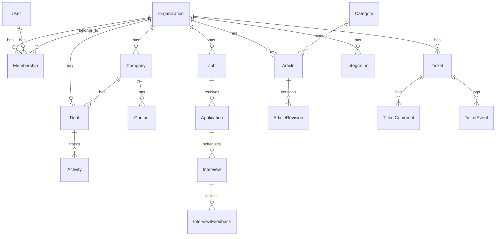

<div align="center">

# 🔧 OpsForge

### The Self-Hosted Internal Business Platform

**Replace fragmented SaaS subscriptions. Own your data. Run your operations.**

[](https://www.ruby-lang.org/)
[](https://rubyonrails.org/)
[](https://www.postgresql.org/)
[](https://tailwindcss.com/)
[](https://www.docker.com/)
[](https://github.com/features/actions)
[](LICENSE)

---

OpsForge is a modular, self-hostable internal business platform built with **Ruby on Rails 8**. Designed for growth-stage companies, it consolidates CRM, recruitment, knowledge base, support ticketing, and integrations into a single, cohesive application — so you can ditch the SaaS sprawl and retain **full control over your data**.

[Getting Started](#-getting-started) · [Modules](#-core-modules) · [Architecture](#-architecture) · [API Routes](#-api--routes) · [Contributing](#-contributing)

</div>

---

## ✨ Why OpsForge?

| Problem | OpsForge Solution |
|---|---|
| 💸 Paying for 5+ SaaS tools that barely talk to each other | One unified platform with shared data layer |
| 🔒 Customer and employee data scattered across third-party servers | Self-hosted — your data never leaves your infrastructure |
| 🧩 Painful integrations between CRM, ATS, ticketing, and docs | Natively integrated modules with cross-entity search |
| 👥 Per-seat pricing that scales against you | MIT licensed, unlimited users |

---

## 📦 Core Modules

<table>
<tr>
<td width="50%" valign="top">

### 🏢 IAM & Organizations
Multi-tenant workspace management with **5-tier role hierarchy**:
- `Owner` → `Admin` → `Manager` → `Member` → `Reader`
- Invitation system with token-based onboarding
- Organization switching & JSONB settings per tenant
- Session-based authentication with `bcrypt`

</td>
<td width="50%" valign="top">

### 💼 CRM
Full customer relationship management:
- **Companies** — with industry, domain, status, and assignment
- **Contacts** — linked to companies with title & contact info
- **Deals** — pipeline stages: `lead` → `qualified` → `proposal` → `closed_won` / `closed_lost`
- **Activities** — polymorphic tracking (notes, calls, emails, meetings)
- **Tasks** — assignable with priority & due dates

</td>
</tr>
<tr>
<td width="50%" valign="top">

### 🎯 Recruitment / ATS
Applicant tracking from job posting to hire:
- **Job Postings** — by department & location with draft/published status
- **Candidate Directory** — searchable profiles with resume summaries
- **Application Tracking** — stage management: `applied` → `screening` → `interview` → `offer` → `hired`
- **Interviews** — scheduling with structured feedback & ratings

</td>
<td width="50%" valign="top">

### 📚 Knowledge Base
Internal documentation with version control:
- **Categories** — organized with slug-based routing
- **Articles** — rich-text editing via **Action Text**
- **Revision History** — full versioning with content snapshots
- **File Attachments** — via **Active Storage**

</td>
</tr>
<tr>
<td width="50%" valign="top">

### 🎫 Support Ticketing
Internal helpdesk with full audit trails:
- **Tickets** — with category, priority (`low`/`normal`/`high`/`urgent`), and status tracking
- **Threaded Comments** — public replies and **internal notes**
- **Event Log** — JSONB-powered audit trail of all ticket changes
- **Assignment** — requester and assignee tracking

</td>
<td width="50%" valign="top">

### 🔌 Integrations & Notifications
Extensible integration layer:
- **Integration Registry** — per-provider with encrypted credentials
- **Webhook Receiver** — ingest external events with payload storage
- **Notifications** — polymorphic, in-app notifications with read/unread tracking
- **Health Check** — built-in `/up` endpoint

</td>
</tr>
</table>

### 🔍 Cross-Module Global Search

A unified search bar that queries across **Companies**, **Deals**, **Tickets**, and **Articles** simultaneously — powered by PostgreSQL `ILIKE` for instant, no-config full-text matching.

---

## 🏗 Architecture

```
┌─────────────────────────────────────────────────────────────────┐
│                        OpsForge Platform                        │
├─────────────────────────────────────────────────────────────────┤
│                                                                 │
│   ┌──────────┐  ┌──────────┐  ┌──────────┐  ┌──────────┐      │
│   │   CRM    │  │   ATS    │  │    KB    │  │ Support  │      │
│   │ Module   │  │ Module   │  │  Module  │  │  Module  │      │
│   └────┬─────┘  └────┬─────┘  └────┬─────┘  └────┬─────┘      │
│        │              │              │              │            │
│   ┌────┴──────────────┴──────────────┴──────────────┴────┐      │
│   │              Organization (Multi-Tenant)              │      │
│   └──────────────────────┬───────────────────────────────┘      │
│                          │                                      │
│   ┌──────────────────────┴───────────────────────────────┐      │
│   │         IAM · Memberships · Roles · Sessions          │      │
│   └──────────────────────┬───────────────────────────────┘      │
│                          │                                      │
│   ┌──────────┐  ┌────────┴─────┐  ┌──────────────────┐        │
│   │ Webhooks │  │  PostgreSQL  │  │  Integrations    │        │
│   │ Receiver │  │    16-alpine │  │  + Notifications │        │
│   └──────────┘  └──────────────┘  └──────────────────┘        │
│                                                                 │
└─────────────────────────────────────────────────────────────────┘
```

### Tech Stack

| Layer | Technology |
|---|---|
| **Framework** | Ruby on Rails 8.0 |
| **Language** | Ruby 3.3 |
| **Database** | PostgreSQL 16 (Alpine) |
| **Frontend** | Tailwind CSS + Hotwire (Turbo + Stimulus) |
| **JS Bundling** | Importmap (zero-Node.js) |
| **Rich Text** | Action Text |
| **File Storage** | Active Storage |
| **Auth** | `bcrypt` + `has_secure_password` |
| **Server** | Puma 6 with jemalloc allocator |
| **Containerization** | Docker + Docker Compose |
| **CI/CD** | GitHub Actions |
| **Testing** | RSpec + Factory Bot + Faker + Capybara |
| **Linting** | RuboCop (Rails Omakase) |
| **Security** | Brakeman (static analysis) |

---

## 🚀 Getting Started

### Prerequisites

- [Docker](https://docs.docker.com/get-docker/) & [Docker Compose](https://docs.docker.com/compose/install/) **or**
- Ruby 3.3+, PostgreSQL 16+, and Bundler

### Option 1: Docker Compose (Recommended)

```bash
# 1. Clone the repository
git clone https://github.com/tunirwabhitkar/OpsForge.git
cd opsforge

# 2. Copy and configure environment variables
cp .env.example .env

# 3. Build and start all services
docker compose up --build

# 4. In a new terminal, prepare the database
docker compose exec web bundle exec rails db:prepare

# 5. Open your browser
# → http://localhost:3000
```

### Option 2: Local Development

```bash
# 1. Clone and install dependencies
git clone https://github.com/tunirwabhitkar/OpsForge.git
cd opsforge
bundle install

# 2. Configure environment
cp .env.example .env
# Edit .env with your local PostgreSQL credentials

# 3. Setup database
rails db:prepare

# 4. Start the server
bin/rails server
# → http://localhost:3000
```

### Environment Variables

| Variable | Description | Default |
|---|---|---|
| `RAILS_ENV` | Application environment | `development` |
| `DB_HOST` | PostgreSQL host | `localhost` |
| `DB_USERNAME` | Database username | `postgres` |
| `DB_PASSWORD` | Database password | `postgres` |
| `RAILS_MASTER_KEY` | Encryption key for credentials | — |
| `OPSFORGE_DATABASE_PASSWORD` | Production database password | — |

---

## 🛣 API & Routes

OpsForge organizes routes into namespaced modules for clean separation:

```ruby
# Authentication
resource  :session                          # Sign in / out
resources :registrations                    # Sign up

# Multi-tenancy
resources :organizations                    # Create / switch orgs

# CRM Module
namespace :crm do
  resources :companies { resources :activities }
  resources :contacts
  resources :deals { get :pipeline }        # Pipeline + table views
  resources :tasks
end

# Recruitment / ATS Module
namespace :ats do
  resources :jobs
  resources :candidates
  resources :applications { resources :interviews }
end

# Knowledge Base Module
namespace :kb do
  resources :categories
  resources :articles
end

# Support Module
namespace :support do
  resources :tickets { resources :ticket_comments }
end

# Platform
resources :integrations                     # Integration registry
get "search" => "search#index"             # Cross-module search
get "up"     => "rails/health#show"        # Health check
```

---

## 🧪 Testing

OpsForge uses **RSpec** with a comprehensive test toolkit:

```bash
# Run the full test suite
bundle exec rspec

# Run specific module tests
bundle exec rspec spec/models/

# Run with verbose output
bundle exec rspec --format documentation
```

**Test Stack:**
- **RSpec Rails 6** — BDD-style test framework
- **Factory Bot** — test data factories
- **Faker** — realistic fake data generation
- **Database Cleaner** — clean state between tests
- **Capybara + Selenium** — integration/system tests
- **Brakeman** — security static analysis

### CI Pipeline

Every push and PR to `main`/`master` triggers the GitHub Actions pipeline:

1. ✅ Checkout code
2. ✅ Set up Ruby 3.3 with bundler cache
3. ✅ Spin up PostgreSQL 16 service container
4. ✅ Run `db:create` and `db:schema:load`
5. ✅ Execute full RSpec suite

---

## 📁 Project Structure

```
opsforge/
├── app/
│   ├── controllers/
│   │   ├── ats/                  # Recruitment controllers
│   │   ├── crm/                  # CRM controllers
│   │   ├── kb/                   # Knowledge Base controllers
│   │   ├── support/              # Support controllers
│   │   ├── dashboard_controller.rb
│   │   ├── integrations_controller.rb
│   │   ├── search_controller.rb
│   │   └── sessions_controller.rb
│   ├── models/                   # 18 domain models
│   └── views/
│       ├── layouts/              # Tailwind sidebar layout
│       └── dashboard/            # KPI overview cards
├── config/
│   ├── routes.rb                 # Namespaced RESTful routes
│   └── database.yml              # Multi-environment PG config
├── db/
│   └── migrate/                  # 6 migration files
├── spec/                         # RSpec test suite
├── .github/workflows/ci.yml     # GitHub Actions pipeline
├── docker-compose.yml            # Dev environment stack
├── Dockerfile                    # Production container
└── Gemfile                       # Dependency manifest
```

---

## 🗄 Database Schema

OpsForge uses **18 interconnected tables** across 6 domain migrations:



---

## 🤝 Contributing

We welcome contributions! Here's how to get started:

1. **Fork** the repository
2. **Create** a feature branch: `git checkout -b feature/amazing-feature`
3. **Write tests** for your changes
4. **Ensure** all tests pass: `bundle exec rspec`
5. **Lint** your code: `bundle exec rubocop`
6. **Commit** with clear messages: `git commit -m 'Add amazing feature'`
7. **Push** to your fork: `git push origin feature/amazing-feature`
8. **Open** a Pull Request

### Development Guidelines

- Follow **Rails conventions** and the [Rails Omakase](https://github.com/rails/rubocop-rails-omakase) style guide
- All models must be **scoped to an organization** (multi-tenancy)
- Write **RSpec tests** for new features
- Run **Brakeman** before submitting PRs: `bundle exec brakeman`

---

## 📄 License

OpsForge is open-sourced under the **[MIT License](LICENSE)** — use it, modify it, self-host it, go wild.

---

<div align="center">

**Built with ❤️ using Ruby on Rails 8**

[⬆ Back to top](#-opsforge)

</div>
